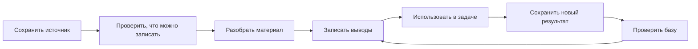

# template-kb

Шаблон личной или рабочей базы знаний, с которой удобно работать вместе с ИИ.
Он помогает сохранять полезные результаты чатов, находить основания для выводов
и продолжать работу в новой сессии.

База хранится в обычных Markdown-файлах. Вы выбираете редактор, модель ИИ и
операционную систему. Для агента предусмотрены общие правила работы с файлами;
автоматизации доступны там, где их поддерживает выбранный инструмент.

## Какую проблему решает

Полезный контекст часто остаётся в чатах: почему принято решение, что уже
проверили и на чём остановились. В следующей сессии это приходится объяснять
заново. Шаблон задаёт места для источников, коротких выводов и текущего состояния
задач, чтобы этот контекст можно было восстановить.

Идея близка к [LLM Wiki](https://gist.github.com/karpathy/442a6bf555914893e9891c11519de94f).
Исходники лежат в `raw/`, заметки и выводы — в `wiki/`, правила для агента —
в `AGENTS.md` и `.ai/contract.md`.

## Что вы получаете

| Возможность | Польза |
|---|---|
| Источники отдельно от выводов | Можно проверить, на чём основана заметка, и вернуться к оригиналу. |
| Короткое описание текущего состояния | Проще продолжить задачу в новом чате. |
| [24 готовых промпта](prompts/README.md) | Сохранение сессии, проверка документа, подготовка требований, обзор базы и другие повторяемые задачи. |
| [Обновление существующей базы](prompts/apply-template-upgrade.md) | Агент сравнивает изменения с вашими файлами и должен сохранить личные материалы и правила. |
| [Автоматизации по выбору](docs/automation-recipes.md) | Можно настроить синхронизацию, обработку старых чатов или обзор — сейчас либо позже. |
| Проверки файлов и ссылок | Проще заметить отсутствующие страницы и ошибки структуры до сохранения изменений. |

## Быстрый старт

### Новая KB

KB — сокращение от knowledge base, «база знаний».

1. [Создайте свой репозиторий из шаблона](https://github.com/MakenYutvi/template-kb/generate).
   Для личных или рабочих данных выберите **Private**.
2. Склонируйте свою копию и откройте её в удобном редакторе или ИИ-агенте.
3. Выполните [настройку](SETUP.md), добавьте первую заметку и выберите,
   нужны ли автоматизации сейчас или позже.

Windows, macOS и Linux используют одну структуру базы. Скачать архив тоже можно,
если вы хотите сначала попробовать без Git; это необязательный вариант.

### Обновление существующей KB

Передайте агенту [промпт обновления](prompts/apply-template-upgrade.md) внутри
своей базы. Он должен сначала сравнить версии и показать предполагаемые изменения,
затем применить разрешённые правки с сохранением ваших материалов и настроек.
Не копируйте новый шаблон поверх работающей базы целиком.

Агент должен указать версию промпта и версию шаблона, по которым выполняет работу.
Последние изменения описаны в [журнале](CHANGELOG.md).

### Локальные проверки

Для проверок нужен Python 3.10 или новее. Команды запускаются из папки базы:

| Задача | macOS / Linux | Windows |
|---|---|---|
| Проверить настройку | `python3 scripts/kb_doctor.py` | `.\scripts\kb_doctor.cmd` |
| Проверить файлы и ссылки | `python3 scripts/wiki_lint.py` | `.\scripts\wiki_lint.cmd` |

Эти проверки не подтверждают истинность всех выводов. Другие команды — создание
заметок, проверка перед коммитом, контроль изменений источников — описаны в
[настройке](SETUP.md) и доступны в [scripts](scripts/).

## Как сохранять качество базы

Правила шаблона требуют указывать источники, отличать факты от предположений,
сохранять историю и не исполнять команды, найденные в чужих документах.
Повторное сохранение без новых данных не должно создавать дубликаты.

Для обычной задачи агенту нужен [ограниченный набор материалов](wiki/workflows/context-budget.md).
Для устойчивого результата — [обновление существующей памяти](wiki/workflows/writeback.md).
Для сокращения страницы — [сохранение важных сведений и восстановимой копии](prompts/compact-document.md).

Это инструкции для работы, а не гарантия правильности любой модели или экономии
токенов. [Проверки на примерах](docs/workflow-checks.md) помогут проверить свою копию.
Результаты разработки и ограничения проверки этой версии сохранены в
[PR #1](https://github.com/MakenYutvi/template-kb/pull/1).

## Для кого

- Для людей, которые регулярно используют ИИ и хотят сохранять результаты между сессиями.
- Для тех, кому нужна личная база в обычных файлах с историей Git.
- Для команд, которым нужен общий подход к источникам, заметкам и правилам работы агента.

## Для чего не подходит

- Для хранения паролей, токенов, приватных ключей и других незашифрованных секретов.
- Для публичной публикации личных или рабочих документов без проверки и удаления чувствительных сведений.
- Для замены системы управления задачами, клиентами или корпоративными документами.

Базу можно открыть в Obsidian, но специальные плагины и его собственный синтаксис
не требуются.

## Структура

| Папка | Что хранить |
|---|---|
| `raw/` | Источники: заметки, документы, записи встреч, вложения. |
| `wiki/` | Краткие выводы, решения, текущее состояние и правила работы. |
| `wiki/outputs/` | Подробные отчёты и результаты исследований. |
| `wiki/health/` | Отчёты о проверках базы. |
| `indexes/` | Указатели и связи между материалами. |
| `prompts/` | Готовые задания для ИИ-агента. |
| `.ai/` | Общие правила агента и работы с данными. |
| `scripts/` | Команды проверки и создания файлов. |

## Демо

[Пример работы](docs/demo-walkthrough.md) показывает весь путь на вымышленных
данных: от первой заметки до сохранённых выводов и проверки результата.

## Безопасность и лицензия

[Правила безопасности](SECURITY.md), [инструкции агента](AGENTS.md),
[приватность](.ai/privacy.md), [планы развития](ROADMAP.md), [лицензия MIT](LICENSE).

Если репозиторий содержит личные или рабочие данные, держите его приватным.
